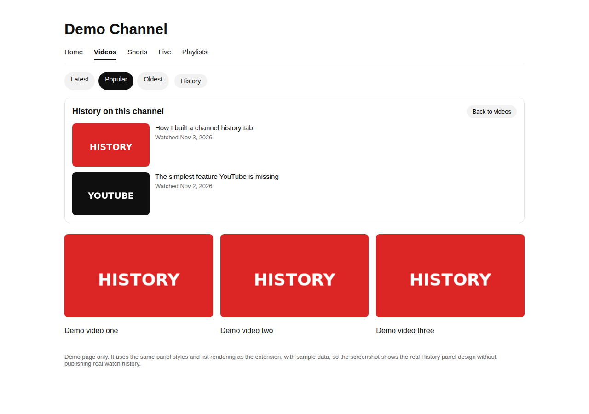
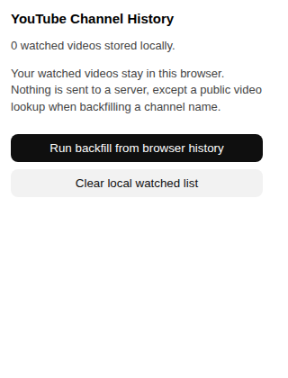
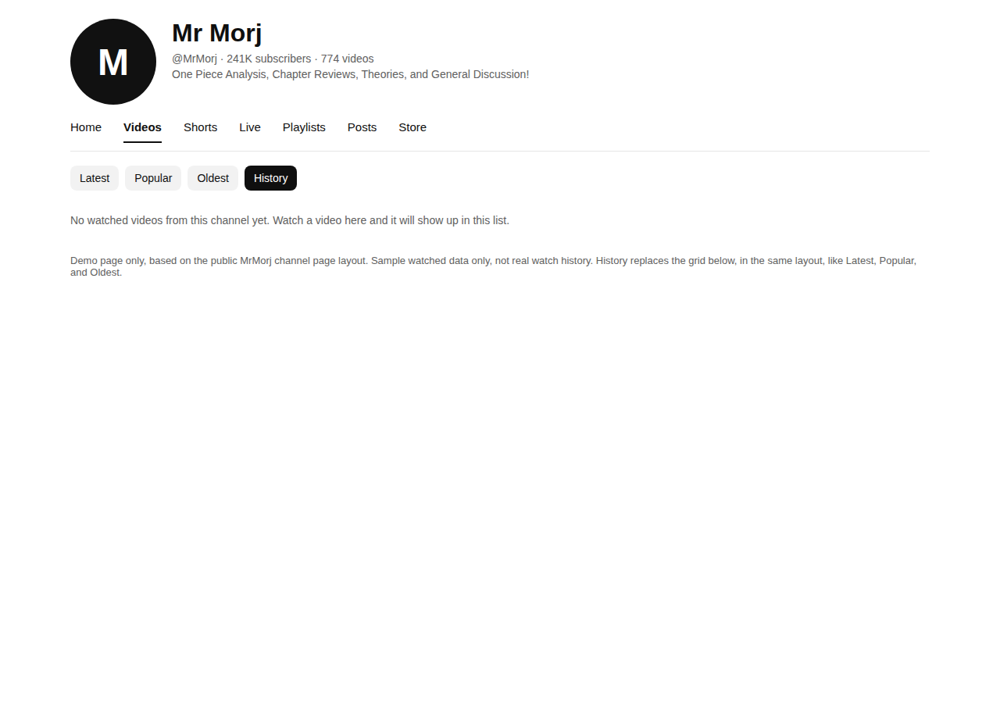

# YouTube Channel History

A Chrome extension that adds a History view to a YouTube channel, so you can see the videos you watched from that channel, in one place.

Open a channel Videos page. Next to Latest, Popular, and Oldest, you will see a History chip, in the same row and at the same size. Click it and it looks selected, and the grid below changes to that channel's watched videos, newest watched first, in the same video layout, with a link back to each video and the date you watched it. Click Latest, Popular, Oldest, or History again to bring the normal grid back.







Screenshots use demo data, not real watch history. The History grid in the screenshots uses the same grid code and styles as the extension.

## Install, load unpacked

1. Download or clone this repo.
2. Open Chrome, go to `chrome://extensions`.
3. Turn on Developer mode, top right.
4. Click Load unpacked, and pick this folder.
5. Open a YouTube channel Videos page and click History.

No Chrome Web Store listing is included in this repo. Loading unpacked is the install path for now.

## How it works

Three sources, all stored in your browser with `chrome.storage.local`:

- Channel grid, the most complete source on the page itself: when you click History, the extension first scans the channel grid already on screen for videos YouTube marks as watched, with the red progress bar on the thumbnail. That list is synced to your signed-in YouTube account, so it includes videos you watched on another device, and it needs no browser history and no lookup. Scroll the channel page to load more videos, then open History again, and newly loaded watched videos are added to the stored list.
- Track forward: when a YouTube video page loads, the extension records the video, its title, and the channel from that page.
- Backfill: the popup has a Run backfill button. It reads your browser history for `youtube.com/watch` pages, up to 1000 items, and looks up the channel for each video with the public YouTube oEmbed endpoint, which needs no key and no sign-in. Backfill runs in batches of 200, up to 1000 lookups per run, and it also re-checks videos already stored without a channel, so a failed lookup is not stuck forever.

A watch is recorded when a video page loads. It is not measured by how long you watched. That is a known limit, and a watch-time threshold is a possible next step, not part of this version.

If you click Latest, Popular, or Oldest, YouTube replaces the chip bar, which used to delete the History chip until you refreshed the page. The extension now watches for that replacement and puts History back in the new chip bar, without a refresh.

## Privacy

Your watched list stays in your browser. There is no account, no server, and no analytics in this extension.

The one exception is backfill: to learn a channel name for a video already in your browser history, backfill sends that video URL to the public YouTube oEmbed endpoint. No sign-in is used, and no other data is sent with it.

You can clear the stored list at any time from the popup.

Permissions, and why each is needed:

- `storage`: store the watched list in your browser.
- `history`: backfill from browser history, only when you run backfill, and on install.
- Host permission for `youtube.com`: inject the History button on channel pages, and read the channel from a video page you are already viewing.

## Limits, stated plainly

- Backfill is capped, not literally every video ever watched. Browser history retention and the 1000 item search cap bound it. Videos whose channel lookup fails are kept without channel info, and a later backfill re-checks them, so they are not stuck without a channel forever. For a complete list on a channel you are looking at, the channel grid scan above is the better source, because it uses YouTube's own watched markers, not your local browser history.
- YouTube can change its page layout. The extension looks for the Latest, Popular, and Oldest chips in their chip bar, adds History as a chip in that same bar, and replaces the grid items container below it. If those chips are not found, it falls back to placing a History button above the video grid. Placement on a live, real YouTube channel page has not yet been verified in the sandbox used to build this, because that sandbox blocks youtube.com. Loading it unpacked on a real browser and checking a real channel page is the next verification step, and is not claimed here.
- Shorts, embeds, and live pages are parsed for a video id where possible, but the main path tested is a standard watch page and a channel Videos page.

## Development

Tests are plain Node, no build step:

```
node tests/test.js
```

The demo page at `demo/channel-mock.html` renders the same chip and grid styles and code with sample data, for screenshots without publishing real watch history.

## Files

- `manifest.json`: Manifest V3, permissions, content script, popup, background worker.
- `src/shared.js`: parsing, channel matching, dedupe, sorting, and rendering. Shared by the extension and the tests.
- `src/content.js`: History chip, grid replacement and restore, and forward watch recording on YouTube pages.
- `src/content.css`: History chip and grid styles.
- `src/background.js`: storage, backfill from browser history, and oEmbed channel lookup.
- `src/popup.html`, `src/popup.js`: count, backfill button, and clear button.
- `src/` icons in `icons/`: extension icons.
- `demo/`: demo channel page and placeholder thumbnails, sample data only.
- `tests/test.js`: parsing, channel match, filter, dedupe, sort, rendering, and escaping.

## License

MIT. See `LICENSE`.
